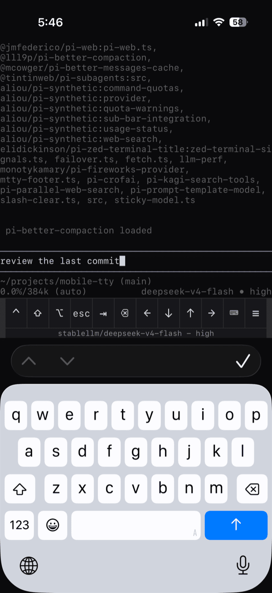
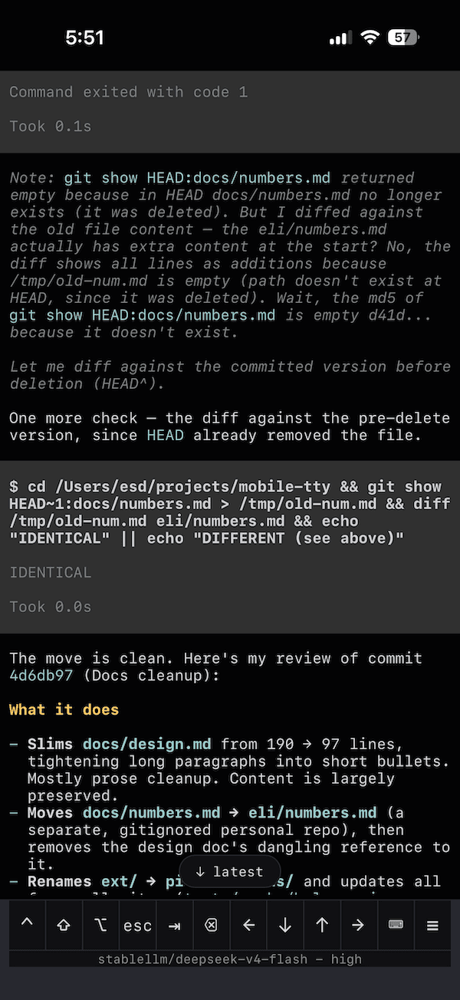

# afield

Use the [pi](https://www.npmjs.com/package/@earendil-works/pi-coding-agent) coding agent from your phone's browser. Pi runs on your computer, and afield streams its terminal to the browser so you can send prompts and follow the output. Sessions keep running when you disconnect as long as the server and the computer stay up.

- Watch and type in one session from several devices, or attach from a normal terminal.
- Open a plain terminal running your shell, beside pi or without it.
- Run several sessions on one server and switch between them from the menu.

<p>
  
    &nbsp;
  
</p>

## Requirements

- **Node 22+** on macOS or Linux.
- **pi**, installed and logged in: `npm install -g @earendil-works/pi-coding-agent`, then run `pi` once. Without pi, `serve --no-pi` offers terminals only.
- **A trusted network for the setup below.** The sign-in key is sent over plain HTTP.

## Quick start

On your computer, in the folder you want pi to work in:

```sh
npx afield --lan
```

Leave that terminal open. On your phone, join the same Wi-Fi and scan the QR code the server prints, or open one of its links and type the sign-in key it prints. On iPhone, **Add to Home Screen** gives you more rows and keeps the sign-in.

On later visits the page reopens the conversation you last viewed in that browser, or a running session. On a first visit it opens your most recent pi conversation, which may be in another folder. Use `≡` → **New session** to start in the folder you ran `serve` from.

To try it only on this computer, skip `--lan` and open the link it prints.

`npm install -g afield` lets you type `afield` rather than `npx afield`.

## Recommended usage

- **This computer:** `afield`, then open the link it prints.
- **Same Wi-Fi:** the Quick start setup.
- **Away from home:** Tailscale on both devices, then `afield serve --bind <tailnet-IP>` using the address from `tailscale ip -4`. With MagicDNS add `--hostname <machine-name>`.
- **Public URL:** a Cloudflare tunnel or another HTTPS proxy, with `serve --hostname <public name>`. See [Remote access](#remote-access).

## Limitations

- **No full-screen apps** using the alternate screen, including vim and Claude Code.
- **Tested on iPhone Safari.** Android seems to work but is not fully tested.
- **Scrollback is 10,000 lines** (`--scrollback N` to change), kept across reconnects. 100k or more will cause problems on mobile devices.
- **Viewers share one terminal size.** The narrowest viewer sets both rows and columns.
- **Stopping the server ends all sessions.** After a restart, an open page reopens the pi conversation it was showing, minus any reply in progress.

## Connection problems

- **Phone can't load the page:** the QR code uses the first address the server found, which may belong to a Docker or VPN network the phone cannot reach. Use `--bind` with the computer's Wi-Fi address instead of `--lan`.
- **Page loads, terminal never connects:** check the server output, and pass `--hostname` when a proxy presents a name.

## Everyday usage

```sh
afield serve              # start the server
afield sessions           # list running sessions and viewer counts
afield new                # start a fresh pi in this folder and attach
afield new --shell        # start a terminal running your $SHELL instead
afield attach NAME        # join a session in this terminal, Ctrl-] detaches
afield end NAME           # stop a session after confirmation
```

`NAME` matches a session's label, folder, path or ID, ignoring case. Omit it to choose from a list, or give a number to select that row from `afield sessions`. Bare `afield` starts the server, or lists running sessions if it is already up.

```sh
afield end --yes NAME               # skip confirmation
afield serve pi --model MODEL       # pass arguments to pi
afield serve --no-pi                # terminals only, for a machine without pi
afield serve --port 1234            # choose the port
```

### Sessions

- Pick a saved conversation from the `≡` menu to start or join it.
- Leaving, detaching or disconnecting keeps a session running. Switching sessions does not end the previous one.
- **New session** offers the folder you ran `serve` in, folders from saved conversations and **Other folder…**. `--new-dir DIR` changes the default. **New terminal** offers the same folders and runs your `$SHELL` as a login shell. A terminal has no transcript, so it is gone once it ends.
- **End** stops a session without deleting its transcript. Tap twice to confirm. Exiting pi or the shell does the same.
- Up to ten sessions run at once. `--cap N` changes the limit. At the limit you choose one to end before starting another.

The menu shows running conversations first, then saved ones. Each group is newest first. Subagent runs and other forked conversations are not listed separately. pi's `/new` and `/resume` switch conversations without disconnecting anyone watching. `/resume` into a transcript already open in another terminal is refused.

○ marks a running session. With pi 1.1.0+, ⏳️ marks one that is working and ● marks one that stopped while nobody was watching, either finished or waiting for you.

### Phone controls

- **Key bar:** `⌃`, `⇧` and `⌥` are sticky. Tap `⌃`, then `c` for Ctrl-C. Backspace and arrows repeat when held. `⌨` toggles the keyboard and `≡` opens the menu.
- **Scrolling:** drag to scroll. Tap **↓ N new** to jump to the bottom.
- **Menu:** sessions, Top/Bottom, Paste, terminal size, zoom, reconnect, Clear view, Reload app and diagnostics. ⚡ appears while connecting or disconnected.

Short disconnects keep the last screen visible and replay your keystrokes once reconnected.

### Configuration

`AFIELD_PORT`, `AFIELD_BIND`, `AFIELD_HOSTNAME`, `AFIELD_THEME` and `AFIELD_NEW_DIR` work like the matching flags. pi history is read from `~/.pi/agent/sessions`, or `PI_CODING_AGENT_SESSION_DIR` if set.

## Remote access

The sign-in key protects every connection, a tunnel's included. Tailscale and Cloudflare Access also control who can reach the server at all.

### Tailscale

Install Tailscale on the computer and phone. Start the server bound to the tailnet address from `tailscale ip -4`, not to all interfaces:

```sh
afield serve --bind <tailnet-IP>
```

Scan the QR code it prints. With MagicDNS add `--hostname <machine-name>`, and the QR code uses that name.

### Cloudflare tunnel

Any tunnel or proxy that serves HTTPS and forwards to the server on this machine works. For a Cloudflare tunnel you need `cloudflared` and a domain on Cloudflare. Once:

```sh
cloudflared tunnel login
cloudflared tunnel create afield
cloudflared tunnel route dns afield pi.example.com
```

Every time, in two terminals:

```sh
cloudflared tunnel run --url http://127.0.0.1:7681 afield
afield serve --hostname pi.example.com
```

With `--hostname`, the QR code and link use `https://` and that name. Cloudflare Access can add a login in front, but the sign-in key is enough on its own.

### Sign-in

Each browser signs in once with a key. The key is made on first use and kept in `~/.config/afield/key`, or under `$XDG_CONFIG_HOME`. To pick your own instead, run `afield set-key`. Capitals, spaces and dashes don't count. `serve` prints the key, with a QR code and links that sign a browser in, and CLI commands read it from the file. Signing in survives server restarts. Delete the file or set a new key, then restart the server, to sign every device out. `serve --no-sign-in` lets every connection in.

### Security

The key opens a shell on your computer. Keep in mind:

- **Plain HTTP:** on `--lan` the key can be read off the network. Use it only on a network you trust.
- **Logs and history:** the printed links carry the key in their address, so a proxy that logs full URLs, or the browser's history, may keep it. Typing the key into the sign-in page avoids this.
- **Guessing:** nothing limits attempts, so a key you pick with `set-key` should be long.

### Proxies and hostnames

Behind a proxy, pass the public name with `--hostname` or `AFIELD_HOSTNAME`. The terminal won't connect under any other name, but IP addresses and `localhost` always work. Only browser WebSocket handshakes are checked.

## Optional pi extension

**Footer** shows the current model and thinking level on an iPhone home-screen app, where pi's own footer gets cut off. With `pi-subagents` installed it also counts background subagents as work in progress. It does not draw in a browser tab or an Android home-screen app, and does nothing outside afield.

```sh
pi install "$(npm root -g)/afield/pi-extensions/afield-footer.ts"
```

## Development

```sh
git clone https://github.com/elidickinson/afield && cd afield
npm install
./afield serve
```

There is no build step. Client edits need a page reload. Server edits need a restart, which ends running sessions. Install extensions from `./pi-extensions/`.

```sh
npm test                # unit tests and snapshot round-trips
npm run typecheck       # vendored TypeScript renderer
npm run test:e2e        # WebKit with fake pi
npm run test:integrity  # verify viewers receive no gaps
npm run test:smoke      # real pi, no prompts or token costs
npm run test:real-pi    # real pi, resized mid-draw
```

See [design and architecture](docs/design.md) for how it works and why.
